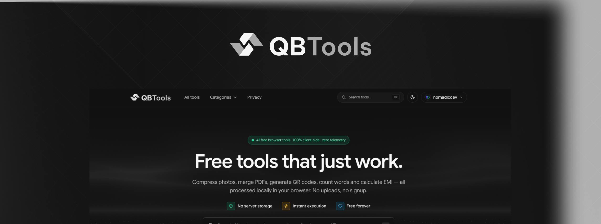
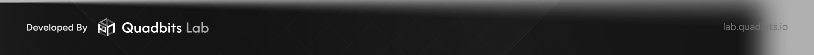

# 🛠️ QBTools — Free, Private Everyday Web Tools

<p align="center">
  
</p>

<p align="center">
  <strong>A blazing fast, privacy-first web suite of 42 everyday tools for creators, developers, students, and professionals.</strong>
  <br />
  <em>No mandatory accounts. No tracking. Zero cloud upload required for local file operations.</em>
</p>

<p align="center">
  <a href="https://bun.sh"></a>
  <a href="https://react.dev"></a>
  <a href="https://tanstack.com/start"></a>
  <a href="https://tailwindcss.com"></a>
  <a href="https://www.typescriptlang.org"></a>
  <a href="https://biomejs.dev"></a>
  <a href="https://www.docker.com"></a>
  <a href="#-privacy--security"></a>
</p>

---

### 📑 Quick Links

[✨ Key Highlights](#-key-highlights) • [🧰 Tools Catalog (42)](#-complete-tools-catalog) • [🚀 Quick Start](#-quick-start) • [📐 Architecture](#-system-architecture) • [📂 Monorepo Layout](#-monorepo-layout) • [🐳 Docker Deploy](#-docker-deployment) • [🔒 Privacy & Security](#-privacy--security) • [⚙️ Configuration](#️-configuration)

---

## ✨ Key Highlights

- ⚡ **100% Client-Side Processing**: Heavy tasks (PDF manipulation, image resizing, video compression, AES-256 encryption, OCR) run entirely inside the user's browser via **WASM & Web Workers**. Your files never touch a remote server unless you explicitly choose to save them to your private cloud storage.
- 🗜️ **WASM & Native Codecs**: Powered by `resvg-wasm`, `transformers.js` (client-side AI background removal), FFmpeg, and native browser codecs (WebP, AVIF, VP9/Opus).
- 📱 **Modern & Responsive UI**: Built with React 19, Tailwind CSS v4, and Radix/Lucide design tokens, optimized for lightning-fast First Contentful Paint and mobile touch targets.
- 🛡️ **Zero-Knowledge Architecture**: Secure client-side hashing, AES-GCM text encryption, and PBKDF2 key derivation.
- ☁️ **Optional Private Media Storage**: Integrated with **Better Auth (GitHub OAuth)**, transactional **PGlite** session management, and **RustFS (S3-compatible)** object storage for logged-in users.
- 📦 **Minimal Docker Footprint**: Multi-stage `oven/bun:latest` runtime bundle with a read-only root filesystem, dropped Linux capabilities, and non-root execution.

---

## 🧰 Complete Tools Catalog

QBTools includes **42 high-performance tools** organized into 8 intuitive categories:

<details open>
<summary><b>🖼️ Image Tools (8)</b> — <i>Click to expand/collapse</i></summary>

| Tool                   | Slug                 | Engine / Technology       | Description                                                                                          |
| :--------------------- | :------------------- | :------------------------ | :--------------------------------------------------------------------------------------------------- |
| **Compress Image**     | `compress-image`     | Native Canvas / WASM      | Reduce image size with fine control over quality, dimensions, and formats (JPEG, PNG, WebP, AVIF).   |
| **Resize Image**       | `resize-image`       | OffscreenCanvas           | Change width and height in pixels or percentage with aspect ratio locking.                           |
| **Convert Image**      | `convert-image`      | Native + `libheif`        | Convert seamlessly between JPG, PNG, WebP, and AVIF, including native Apple HEIC input.              |
| **Background Remover** | `remove-background`  | `ormbg` ONNX / WASM       | Instant, local AI segmentation to cut out people, pets, and products without uploading images.       |
| **OG Banner Maker**    | `og-banner-maker`    | `resvg-wasm` Worker       | Design social Open Graph cards with custom typography, gradients, templates, and 1-click export.     |
| **Favicon Generator**  | `favicon-generator`  | `resvg-wasm` + ZIP        | Generate production favicon kits (ICO, multi-resolution PNG, SVG, webmanifest) in a single ZIP.      |
| **App Icon Generator** | `app-icon-generator` | `resvg-wasm` Worker       | Build complete iOS asset catalogs (`AppIcon.appiconset`), Android adaptive icons, and macOS `.icns`. |
| **PNG to SVG**         | `png-to-svg`         | Image Tracer / Vectorizer | Convert PNG and raster photos into clean, scalable SVG vector graphics.                              |

</details>

<details open>
<summary><b>📄 PDF Tools (8)</b> — <i>Click to expand/collapse</i></summary>

| Tool                     | Slug            | Engine / Technology        | Description                                                                          |
| :----------------------- | :-------------- | :------------------------- | :----------------------------------------------------------------------------------- |
| **Merge PDF**            | `merge-pdf`     | `pdf-lib`                  | Combine multiple PDF files into one neatly ordered document.                         |
| **Split PDF**            | `split-pdf`     | `pdf-lib`                  | Extract specific page ranges or burst all pages into individual files.               |
| **Compress PDF**         | `compress-pdf`  | `pdf-lib` stream optimizer | Shrink PDF file sizes while preserving vector text and embedded formatting.          |
| **Image to PDF**         | `image-to-pdf`  | `pdf-lib`                  | Convert image galleries and document scans into a standardized, paginated PDF.       |
| **Protect PDF**          | `protect-pdf`   | `pdf-lib` encryption       | Encrypt PDF files with user passwords or unlock documents with existing credentials. |
| **Watermark PDF**        | `watermark-pdf` | `pdf-lib` Canvas           | Stamp custom text banners (CONFIDENTIAL, DRAFT) or transparent logo overlays.        |
| **Redact PDF**           | `redact-pdf`    | Canvas + `pdf-lib`         | Draw redaction masks over sensitive information and sanitize the output permanently. |
| **Searchable PDF (OCR)** | `ocr-pdf`       | Tesseract.js WASM          | Perform OCR on scanned PDF pages and produce a searchable, selectable text layer.    |

</details>

<details>
<summary><b>✍️ Text Tools (5)</b> — <i>Click to expand/collapse</i></summary>

| Tool                    | Slug                | Engine / Technology | Description                                                                                       |
| :---------------------- | :------------------ | :------------------ | :------------------------------------------------------------------------------------------------ |
| **Image & PDF to Text** | `extract-text`      | Tesseract.js (WASM) | Extract text from scans and photos with multilingual OCR (English, Arabic, and more).             |
| **Word Counter**        | `word-counter`      | Pure Engine         | Real-time counting for words, characters, sentences, paragraphs, and reading time.                |
| **Case Converter**      | `case-converter`    | Pure Engine         | Instant casing toggles: UPPERCASE, lowercase, Title Case, camelCase, kebab-case, and snake_case.  |
| **Grammar Helper**      | `grammar-checker`   | AI Server Function  | AI-assisted spelling, punctuation, and style suggestions with inline diffs.                       |
| **Paraphrase Helper**   | `paraphrasing-tool` | AI Server Function  | Rewrite sentences and paragraphs across various tones (Professional, Casual, Academic, Creative). |

> [!NOTE]
> _Grammar Helper_ and _Paraphrase Helper_ are the only tools that utilize server-side API processing (via Anthropic SDK). All requests are character-capped (5,000 chars) and IP rate-limited.

</details>

<details>
<summary><b>🎬 Media Tools (6)</b> — <i>Click to expand/collapse</i></summary>

| Tool                 | Slug               | Engine / Technology        | Description                                                                                    |
| :------------------- | :----------------- | :------------------------- | :--------------------------------------------------------------------------------------------- |
| **Video Compressor** | `video-compressor` | FFmpeg WASM / VP9          | Shrink MP4/WebM video file size for Discord, WhatsApp, and email attachments.                  |
| **Audio Trimmer**    | `audio-trimmer`    | Web Audio API / WaveSurfer | Cut audio clips and music with millisecond accuracy, waveform visualization, and fade effects. |
| **Thumbnail Maker**  | `thumbnail-maker`  | OffscreenCanvas            | Create high-CTR YouTube and social media thumbnails with custom banners, text, and badges.     |
| **Video Trimmer**    | `video-trimmer`    | Native / FFmpeg            | Trim, cut, and shorten video timelines with interactive frame scrubbing.                       |
| **Video to Audio**   | `video-to-audio`   | AudioContext / FFmpeg      | Extract clean audio soundtracks (MP3/WAV/AAC) directly from video files.                       |
| **Video to GIF**     | `video-to-gif`     | FFmpeg / WASM              | Convert clips into optimized, looped animated GIFs with custom FPS and palette mapping.        |

</details>

<details>
<summary><b>🛡️ Security & Encryption (3)</b> — <i>Click to expand/collapse</i></summary>

| Tool                | Slug             | Engine / Technology     | Description                                                                                       |
| :------------------ | :--------------- | :---------------------- | :------------------------------------------------------------------------------------------------ |
| **File Encryptor**  | `file-encryptor` | WebCrypto (AES-256-GCM) | Lock any file with a password-derived key using PBKDF2 (100k iterations) and AES-256-GCM.         |
| **Hash & Checksum** | `hash-generator` | WebCrypto / Streaming   | Generate SHA-256, SHA-512, MD5, and CRC32 checksums with chunked 4 MiB streaming for large files. |
| **Text Encryptor**  | `text-encryptor` | WebCrypto (AES-GCM)     | Encrypt confidential messages and notes into a portable, password-protected ciphertext bundle.    |

</details>

<details>
<summary><b>🧮 Calculators (5)</b> — <i>Click to expand/collapse</i></summary>

| Tool                      | Slug                    | Description                                                                                            |
| :------------------------ | :---------------------- | :----------------------------------------------------------------------------------------------------- |
| **Age Calculator**        | `age-calculator`        | Calculate exact chronological age in years, months, days, hours, and count down to upcoming birthdays. |
| **EMI Calculator**        | `emi-calculator`        | Compute monthly loan installments, total payable interest, and view an interactive amortization table. |
| **Percentage Calculator** | `percentage-calculator` | Calculate percentage increases, discounts, fractional ratios, and margin differences.                  |
| **GPA Calculator**        | `gpa-calculator`        | Compute semester and cumulative GPAs across multiple grading scales (4.0, weighted, letter grades).    |
| **BMI Calculator**        | `bmi-calculator`        | Calculate Body Mass Index using metric or imperial measurements with healthy weight guidance.          |

</details>

<details>
<summary><b>⚡ Generators (5)</b> — <i>Click to expand/collapse</i></summary>

| Tool                      | Slug                  | Description                                                                                     |
| :------------------------ | :-------------------- | :---------------------------------------------------------------------------------------------- |
| **QR Code Generator**     | `qr-code-generator`   | Generate styled vector QR codes for URLs, WiFi credentials, vCards, SMS, and plain text.        |
| **Password Generator**    | `password-generator`  | Generate cryptographically secure passwords or memorable multi-word passphrases (EFF wordlist). |
| **Invoice Generator**     | `invoice-generator`   | Create clean, professional, print-ready PDF invoices with custom items, taxes, and branding.    |
| **Signature Maker**       | `signature-generator` | Draw or type personalized digital signatures and export as clean transparent PNGs.              |
| **Barcode Scanner & Gen** | `barcode-scanner`     | Scan barcodes from camera/images or generate EAN, UPC, Code-128, and Code-39 barcodes.          |

</details>

<details>
<summary><b>💻 Developer Tools (2)</b> — <i>Click to expand/collapse</i></summary>

| Tool                      | Slug                    | Description                                                                                            |
| :------------------------ | :---------------------- | :----------------------------------------------------------------------------------------------------- |
| **Code Formatter**        | `code-formatter`        | Format JSON, TypeScript, JavaScript, HTML, CSS, SQL, and Markdown completely offline.                  |
| **Compression Benchmark** | `compression-benchmark` | Compare real-world compression ratios and speed between Gzip, Brotli, and Zstandard on your own files. |

</details>

---

## 📐 System Architecture

```mermaid
flowchart TD
    subgraph Browser ["Client Browser (Zero-Upload Sandbox)"]
        UI["React 19 / TanStack Router UI"]
        WorkerPool["Web Workers & WASM Engine"]
        
        UI -->|File Input| WorkerPool
        WorkerPool -->|resvg-wasm| Resvg["SVG & Icon Rasterizer"]
        WorkerPool -->|ormbg ONNX| ONNX["AI Background Remover"]
        WorkerPool -->|ffmpeg.wasm| FFmpeg["Audio & Video Transcoding"]
        WorkerPool -->|pdf-lib| PDF["PDF Assembly & OCR"]
        WorkerPool -->|WebCrypto| Crypto["AES-256-GCM / SHA-256"]
        
        WorkerPool -->|Instant Processed Output| UI
    end

    subgraph Server ["Server Runtime (Bun + Docker)"]
        SSR["TanStack Start SSR (:8310)"]
        SQLite[("SQLite (bun:sqlite + Drizzle)\nWaitlist, Contacts, Leads")]
        AI["AI Grammar / Paraphrase\n(Anthropic SDK)"]
        
        subgraph PrivateCloud ["Optional Private Cloud (Signed-in)"]
            Auth["Better Auth (GitHub OAuth)"]
            PGlite[("PGlite User State\nFavorites, History")]
            RustFS[("RustFS / S3 Object Store\nEncrypted Media Backup")]
        end
    end

    UI -.->|Page Request / SSR| SSR
    UI -.->|AI Requests Only (Opt-in)| AI
    UI -.->|Explicit Save / Backup| Auth
    Auth --> PGlite
    Auth --> RustFS
    SSR --> SQLite
```

---

## 🚀 Quick Start

### Prerequisites

- [Bun](https://bun.sh) **1.4.0+** (workspace pinned to 1.4.3)
- [Node.js](https://nodejs.org) >= 20 (for Playwright browser drivers if running integration tests)
- [Docker](https://www.docker.com/) & Docker Compose (optional, for containerized deployment)

### 1. Clone & Install

```bash
git clone https://github.com/quadbits/QBTools.git
cd QBTools
bun install
```

### 2. Configure Environment

```bash
cp .env.example apps/web/.env
```
_(Review `apps/web/.env` to configure optional AI keys, analytics, or OAuth credentials)_

### 3. Launch Development Server

```bash
bun run dev
```
Open [http://localhost:8310](http://localhost:8310) in your browser. Live HMR is active across all workspaces!

---

## 💻 CLI Commands Cheatsheet

| Command                  | Workspace      | Description                                                         |
| :----------------------- | :------------- | :------------------------------------------------------------------ |
| `bun run dev`            | `@qbtools/web` | Starts development server with HMR at `http://localhost:8310`       |
| `bun test`               | Root           | Runs unit tests across engines, search index, DB, and widget parity |
| `bun run typecheck`      | Root           | Type-checks all monorepo packages with strict TypeScript            |
| `bun run lint`           | Root           | Runs Biome code analysis and formatting checks                      |
| `bun run format`         | Root           | Applies automated Biome code fixes across the codebase              |
| `bun run build`          | `@qbtools/web` | Compiles production assets and server bundles                       |
| `bun run start`          | `@qbtools/web` | Starts the production Bun web server                                |
| `bun run assets:prepare` | Root           | Compiles and validates versioned WASM artifacts & web workers       |
| `bun run db:backup`      | `@qbtools/db`  | Performs safe online SQLite snapshot (`VACUUM INTO`)                |
| `bun run test:browser`   | Root           | Runs end-to-end Playwright browser integration tests                |

---

## 📂 Monorepo Layout

```
QBTools/
├── apps/
│   └── web/                   # Main TanStack Start application
│       ├── src/routes/        # File-based routes & endpoints (sitemap.xml, robots.txt, etc.)
│       ├── src/components/    # Shared UI components, search modal, widget kit, layout
│       ├── src/tools/<slug>/  # Lazily-loaded tool widgets (heavy libraries load on-demand)
│       └── src/server/        # Server functions (AI, auth, admin, rate-limiting)
├── packages/
│   ├── registry/              # Tool definitions, categories, SEO copy, FAQs, presets, search ranker
│   ├── engines/               # Framework-free pure processing logic (calculators, text, image, pdf)
│   ├── ui/                    # Design tokens (theme.css), buttons, inputs, modals
│   ├── content/               # Educational guides, articles, and documentation
│   └── db/                    # SQLite schemas, Drizzle migrations, and backup tooling
├── docker/
│   └── Dockerfile             # Multi-stage oven/bun:latest container build
├── scripts/                   # WASM preparation, Service Worker compilation, and backup utilities
├── compose.yml                # Docker Compose production definition
└── turbo.json                 # Monorepo pipeline configuration
```

---

## 🛠️ Step-by-Step: Adding a New Tool

QBTools uses an automated registry-driven architecture. To add a new utility:

1. **Define Tool Metadata**:
   Add a `ToolDef` entry to `packages/registry/src/tools/<category>.ts`. Provide its title, slug, SEO description, FAQs, and preset configurations:

   ```ts
   export const newTool: ToolDef = {
     slug: "my-tool",
     name: "My Awesome Tool",
     category: "developer",
     tagline: "Short 1-line benefit.",
     description: "Detailed description...",
     keywords: ["tag1", "tag2"],
     faqs: [...],
     steps: [...]
   };
   ```
2. **Implement Processing Logic**:
   Write framework-independent pure logic in `packages/engines/src/<category>/` and write unit tests in `*.test.ts`.
3. **Build the Widget UI**:
   Create `apps/web/src/tools/<slug>/index.tsx` using the `@qbtools/ui` component kit.
4. **Register the Widget**:
   Export the lazy loader in `apps/web/src/tools/widgets.ts`:

   ```ts
   "my-tool": () => import("./my-tool")
   ```
5. **Verify with Tests**:

   ```bash
   bun test
   ```

   > [!TIP]
   > The test suite automatically asserts widget-registry parity. Search indices, sitemaps, categories, and related tool recommendations will update automatically!

---

## 🐳 Docker Deployment

QBTools is packaged as a multi-stage image that builds and runs on the official `oven/bun:latest` image:

```bash
# 1. Prepare environment
cp .env.example .env

# 2. Build and launch
docker compose up -d --build

# 3. Check container health
docker compose ps
```

### Production Hardening Highlights:

- **Non-Root Execution**: Runs under the unprivileged `bun` user.
- **Read-Only Root Filesystem**: Read-only OS container with only `/tmp` and `/data` writable.
- **Dropped Capabilities**: `cap_drop: ALL` and `no-new-privileges: true`.
- **Zero Node Modules in Runtime**: Self-contained compiled bundle for minimal image size (~50MB).
- **Persistent Data**: SQLite database and WAL journal stored in the `qbtools-data` volume.

> [!NOTE]
> Compose publishes port `8310` directly. Place a reverse proxy (**Caddy**, **Nginx**, **Traefik**, or **Cloudflare Tunnel**) in front for TLS termination, then set `TRUST_PROXY=true` and `HSTS=true`.

---

## ⚙️ Configuration

All configuration flags are documented in [`.env.example`](.env.example). Essential environment variables include:

| Variable                     | Default                   | Purpose                                                         |
| :--------------------------- | :------------------------ | :-------------------------------------------------------------- |
| `SITE_URL` / `VITE_SITE_URL` | `http://localhost:8310`   | Canonical origin for SEO tags, sitemaps, and robots.txt         |
| `PORT`                       | `8310`                    | Web server listening port                                       |
| `ADMIN_TOKEN`                | _(empty)_                 | Secret key for accessing `/admin` (leads, waitlist, CSV export) |
| `AI_API_KEY`                 | _(empty)_                 | Anthropic API key for Grammar and Paraphrasing helpers          |
| `AI_MODEL`                   | `claude-3-5-haiku-latest` | Model used for text transformations                             |
| `BETTER_AUTH_SECRET`         | _(empty)_                 | 32+ character random secret for session encryption              |
| `GITHUB_CLIENT_ID`           | _(empty)_                 | GitHub OAuth application client ID                              |
| `GITHUB_CLIENT_SECRET`       | _(empty)_                 | GitHub OAuth application client secret                          |
| `PGLITE_DATA_DIR`            | `/data/users`             | Directory path for persistent PGlite user database              |
| `S3_ENDPOINT`                | _(empty)_                 | S3 endpoint URL for RustFS private media storage                |
| `VITE_ADSENSE_CLIENT`        | _(empty)_                 | Google AdSense publisher ID (e.g. `ca-pub-...`)                 |
| `VITE_ANALYTICS_SRC`         | _(empty)_                 | URL for lightweight, cookieless analytics (Plausible / Umami)   |

---

## 🔒 Privacy & Security

- **Strict Client-Side Guarantee**: No document, image, or media file is ever transmitted to a server during standard tool usage.
- **Content Security Policy (CSP)**: Hardened headers with `frame-ancestors 'none'`, `object-src 'none'`, and restricted connect domains.
- **Cryptographic Best Practices**: File and text encryption uses standard **AES-256-GCM** with **PBKDF2** key stretching and random nonces.
- **Anti-Abuse**: Forms feature client and server-side Zod validation, honeypot traps, and IP-based sliding window rate limiting.
- **Admin Security**: The admin dashboard is guarded by an HMAC-signed `HttpOnly`, `SameSite=Strict` session cookie.

---

## 📖 Documentation

- [WASM & Browser Processing Engine](docs/WASM.md) — Architecture, benchmarks, limits, and worker pipelines.
- [WASM Validation Report](docs/wasm-validation.md) — Browser compatibility matrix and codec validation.
- [Accounts & Private RustFS Storage](docs/AUTH-STORAGE.md) — OAuth setup, PGlite quotas, backups, and storage semantics.
- [Third-Party Notices](THIRD_PARTY_NOTICES.md) — Open source licenses and attribution for models and fonts.

---

<p align="center">
  <a href="https://lab.quadbits.io" target="_blank" rel="noopener noreferrer">
    
  </a>
</p>
