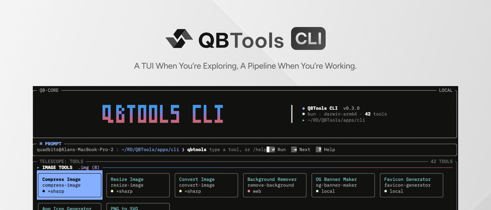
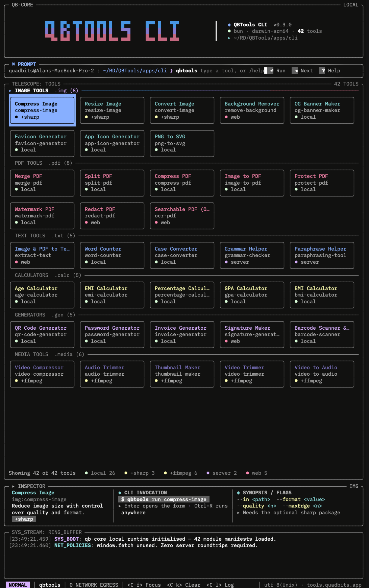
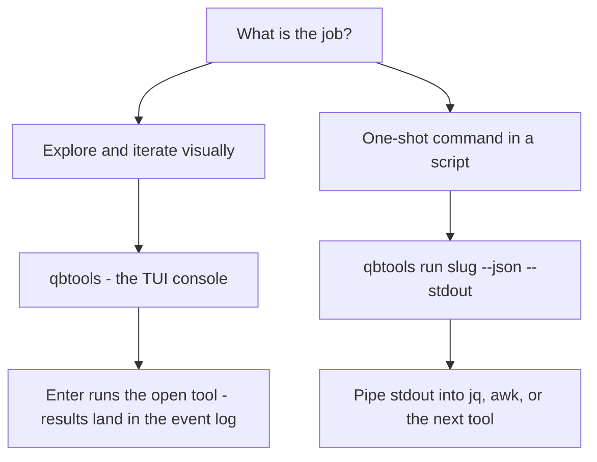

<p align="center">
  
</p>

<p align="center">
  <strong>A privacy-first, interactive TUI for the <a href="https://github.com/Quadbits-Lab/QBTools">QBTools</a> toolkit — 42 tools, a system cleanup utility, and a scriptable headless mode. Built with <a href="https://github.com/vadimdemedes/ink">Ink</a> on <a href="https://bun.sh">Bun</a>.</strong>
  <br />
  <em>Compress, merge, format, and encrypt files locally from the command line. Zero server calls.</em>
</p>

<p align="center">
  <a href="https://www.npmjs.com/package/@quadbits.io/qbtools"></a>
  <a href="https://bun.sh"></a>
  <a href="https://github.com/vadimdemedes/ink"></a>
  <a href="https://www.typescriptlang.org"></a>
  <a href="#-privacy"></a>
  <a href="#-platform-support"></a>
</p>

---

## 📑 Table of Contents

| 🚀 **Getting Started**                                                                                              | 📖 **Reference**                                                                                                                                      |
| :------------------------------------------------------------------------------------------------------------------- | :---------------------------------------------------------------------------------------------------------------------------------------------------- |
| • [✨ Why qbtools](#-why-qbtools)<br/>• [📦 Install](#-install)<br/>• [⚡ 60-Second Tour](#-60-second-tour)<br/>• [🖥️ The Interactive Console](#️-the-interactive-console) | • [🤖 Headless Mode & Scripting](#-headless-mode--scripting)<br/>• [📖 Command Reference](#-command-reference)<br/>• [🧹 System Cleanup](#-system-cleanup)<br/>• [☁️ Accounts & Sync](#️-accounts--sync)<br/>• [🔒 Privacy](#-privacy)<br/>• [🩺 Doctor & Troubleshooting](#-doctor--troubleshooting)<br/>• [📚 Docs & Links](#-docs--links) |

---

## ✨ Why qbtools

- 🖥️ **A real console, not a menu maze.** A card board of all 42 tools grouped by category, a sticky inspector that shows every flag, and a live event log — all in one fixed frame.
- 🤖 **Designed for scripts too.** The same tools run headless with `run`, pipe-friendly flags (`--stdin`, `--stdout`, `--json`), and predictable exit codes.
- 🔒 **Local-first by default.** Files are processed on your machine. The status bar shows the network egress count as you work.
- 🧭 **One tool index everywhere.** Fuzzy search uses the same catalog as the QBTools website, and mistyped slugs suggest the closest real names.
- 🧹 **Cleanup built in.** A read-only scan of caches and junk, with explicit confirmation before anything is deleted.
- ☁️ **Optional sync.** Sign in with an API key to sync favorites, use the AI text helpers, and browse server media storage — or never sign in at all.

---

## 📦 Install

> [!IMPORTANT]
> **Bun ≥ 1.4 must be installed.** The published binary is a Bun script — without Bun on your
> `PATH`, `qbtools` fails with `env: bun: No such file or directory`. Get it at
> [bun.sh](https://bun.sh). There is no Node fallback.

```bash
npm i -g @quadbits.io/qbtools   # published package
```

Or run it without installing:

```bash
npx @quadbits.io/qbtools@latest doctor
```

From a checkout of this repo:

```bash
bun run cli             # bun run --cwd apps/cli start
```

### Optional dependencies

| Dependency | What it unlocks | How to enable |
| :--------- | :-------------- | :------------ |
| `sharp`    | Image tools: compress, resize, convert | `npm i -g sharp` |
| `ffmpeg`   | Media tools: convert, extract, compress | Detected on your `PATH`, never installed |

Both degrade gracefully: unavailable tools report exit code `2` with an install hint instead of failing.

---

## ⚡ 60-Second Tour

Paste and run — everything is read-only or local:

```bash
qbtools                     # launch the interactive UI
qbtools list                # every tool, grouped by category
qbtools search pdf          # fuzzy search across the catalog
qbtools run bmi-calculator --weight 70 --height 175 --json
echo "text to count" | qbtools run word-counter --stdin
qbtools run merge-pdf --in a.pdf --in b.pdf --out merged.pdf
qbtools doctor              # environment check
qbtools help                # everything else
```

---

## 🖥️ The Interactive Console

`qbtools` opens a console, not a screen-per-task app. The frame is fixed:

<p align="center">
  
</p>

**How it works:**

- **A card board, grouped by category.** Every category gets a block header
  (`.img (8) ────`) followed by a grid of tool cards (name + slug), 2–7 per row
  depending on the terminal width.
- **The prompt is the only input.** Type to fuzzy-filter the board (the same
  index the website uses); `cat:slug` narrows to a category (`.img`, `.pdf`, …).
- **The inspector is a sticky strip under the board**, always visible:
  identity (name, `cat:slug`, short description, availability chip like
  `+sharp`) │ CLI invocation │ flags and synopsis. Enter opens the tool there
  and the CLI/flags zone becomes its form, with fields laid out in columns.
  Tab cycles the fields, Ctrl+R runs.
- **A full command runs directly.** `compress-image a.png --quality 80` in the
  prompt runs the tool and writes the result into the event log.
- **The event log** carries system events and tool results, newest last.

`qbtools`, `qbtools ui`, `qbtools tui`, and `qbtools ink` all open the console.

### ⌨️ Keys

| Key            | Action                                     |
| :------------- | :----------------------------------------- |
| ← →            | move across a card row                     |
| ↑ ↓            | move between card rows (across categories) |
| `Enter`        | open the highlighted tool / run / submit   |
| `Tab`          | complete the highlighted tool              |
| `Shift+Tab`    | next / previous field in a tool form       |
| `Space`        | toggle (cleanup categories)                |
| `Ctrl+R`       | run the open tool                          |
| `Y`            | confirm a cleanup                          |
| `Esc`          | clear the prompt / close the card          |
| `Ctrl+F`       | focus the prompt                           |
| `Ctrl+K`       | clear the prompt                           |
| `Ctrl+L`       | clear the event log                        |
| `Ctrl+C`       | cancel a running tool, then quit           |
| `Ctrl+A/E/U/K/W` | edit the focused text field              |

Slash commands: `/help`, `/clear`, `/settings`, `/account`, `/cleanup`, `/update`, `/quit`.

---

## 🤖 Headless Mode & Scripting

Every CLI-available tool runs headless with `qbtools run <slug> [flags]`.



**Shared flags:**

| Flag | Effect |
| :--- | :----- |
| `--in <path>` | Input file (repeatable where the tool accepts multiple inputs) |
| `--out <path>` | Output file |
| `--outdir <path>` | Output directory (multi-output tools) |
| `--stdin` | Read input from stdin |
| `--stdout` | Write the result to stdout |
| `--json` | Emit machine-readable JSON (pairs well with `jq`) |

**Piping examples:**

```bash
echo "some text" | qbtools run word-counter --stdin --json | jq '.words'
qbtools run merge-pdf --in a.pdf --in b.pdf --out merged.pdf
qbtools run word-counter --stdin --stdout < notes.md | sort
```

<details>
<summary><b>Exit codes</b> — <i>click to expand</i></summary>

| Code | Meaning |
| :--- | :------ |
| `0` | Success |
| `1` | Error (bad flags, missing file, tool failure) |
| `2` | Missing optional dependency, or the action requires being signed in |

Unknown subcommands and tool slugs suggest the closest real names
(`run wordcoutner` → `did you mean 'word-counter'?`).

</details>

---

## 📖 Command Reference

| Command | Purpose |
| :------ | :------ |
| `run <slug> [flags]` | Run any tool headless (`--in`, `--out`, `--outdir`, `--stdin`, `--stdout`, `--json`) |
| `list [--category]` | List tools, grouped by category |
| `search <query>` | Fuzzy search the catalog |
| `info <slug>` | Tool details + CLI availability |
| `open <slug>` | Open the tool's web page — also how you reach the 5 browser-only tools (`ocr-pdf`, `extract-text`, `redact-pdf`, `remove-background`, `signature-generator`) |
| `media list\|get\|put` | Server media storage — browse, download, upload (needs sign-in) |
| `cleanup scan\|clean\|analyze` | System cleanup (see [System Cleanup](#-system-cleanup)) |
| `login` / `whoami` / `logout` | Optional account connect via API key |
| `doctor` | Environment diagnostics |
| `completions zsh\|bash\|fish` | Shell completions |
| `config` / `version` / `help` | The rest |

File fields in the TUI autocomplete as you type, and every command is usable offline.

---

## 🧹 System Cleanup

`qbtools cleanup` inventories caches, logs, and other reclaimable disk space, then removes only
what you confirm.

| Command | Behavior |
| :------ | :------- |
| `cleanup scan` | Read-only inventory of your caches |
| `cleanup analyze` | Deeper breakdown per category |
| `cleanup clean` | Preview deletions (dry-run default). `--yes` commits. `--commands` prints the equivalent `brew`/`apt` commands instead of running them |

In the TUI, cleanup categories render as toggleable cards: `Space` toggles, `Y` confirms.
Available categories adapt to the running OS.

---

## ☁️ Accounts & Sync

Signing in is **optional** and never blocks local work:

```bash
qbtools login        # connect via API key
qbtools whoami       # confirm who you are
qbtools logout       # disconnect
```

An account unlocks:

- ☁️ **Favorites sync** — your starred tools follow you across machines
- ✍️ **AI text helpers** — grammar suggestions and paraphrasing (text is capped and rate-limited)
- 📦 **Server media storage** — `qbtools media list | get | put`

Everything else works fully offline.

---

## 🔒 Privacy

- 📁 **Files never leave your machine.** Compression, PDF work, hashing, and encoding all run
  locally — the TUI status bar shows a live `0 NETWORK EGRESS` counter.
- 🌐 **Exactly two exceptions, only when signed in:** the AI text helpers
  (`grammar-checker`, `paraphrasing-tool`) send character-capped, IP-rate-limited text to the
  QBTools server. Requests are disclosed in the product.
- 🚫 **No telemetry, no tracking, no mandatory accounts.**

---

## 🩺 Doctor & Troubleshooting

`qbtools doctor` checks the environment in one command. Common issues:

<details>
<summary><b>Common problems & fixes</b> — <i>click to expand</i></summary>

| Symptom | Cause | Fix |
| :------ | :---- | :-- |
| `env: bun: No such file or directory` | Bun is not installed | Install Bun ≥ 1.4 from [bun.sh](https://bun.sh) |
| Image tools exit with code `2` | `sharp` has no prebuilt binary for your platform | `npm i -g sharp`, or skip image tools |
| Media tools unavailable | `ffmpeg` not on `PATH` | Install ffmpeg and make sure it is on your `PATH` |
| `doctor` reports the local server as unreachable | You are not signed in (or not running the QBTools server) | Normal — everything local still works |

</details>

---

## 📚 Docs & Links

| Document | Contents |
| :------- | :------- |
| [Features](docs/features.md) | The full catalog, tool by tool |
| [Tutorials](docs/tutorials.md) | Hands-on walkthroughs |
| [npm deployment](docs/npm-deployment.md) | Packaging & publishing (maintainers) |
| [Main README](https://github.com/Quadbits-Lab/QBTools#readme) | The web suite, architecture, and monorepo guide |
| [Issues](https://github.com/Quadbits-Lab/QBTools/issues) | Bug reports and feature requests |

---

## 💻 Platform Support

| Platform | Support |
| :------- | :------ |
| macOS | Tier 1 — everything |
| Linux | Tier 1 — everything |
| Windows | Headless mode and the cleanup utility work; the interactive TUI is best-effort |

Cleanup categories adapt to the running OS automatically.

---

<p align="center">
  <sub>Built with <a href="https://github.com/vadimdemedes/ink">Ink</a> and <a href="https://bun.sh">Bun</a> by <a href="https://github.com/Quadbits-Lab">Quadbits Lab</a></sub>
</p>
